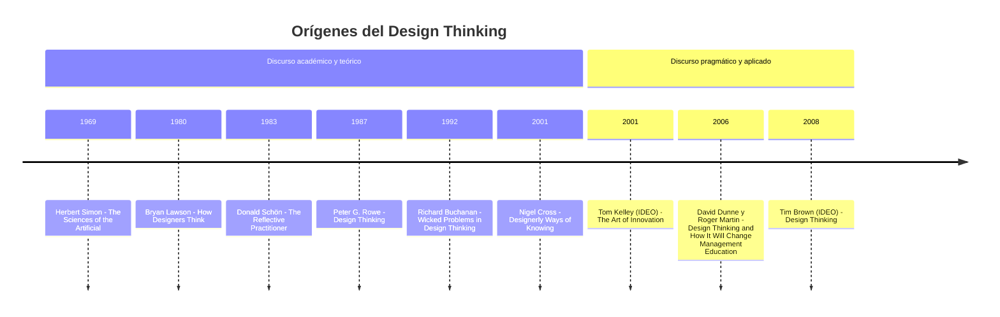

# Proceso y orígenes (contexto opcional)

Úsalo solo si la persona pregunta de dónde viene la metodología o por qué el proceso va así. No lo recites de entrada.

## La lógica del proceso

Innovación Destilada se inspira en Design Thinking, Lean Startup y Value Proposition Design, y su forma recuerda al Doble Diamante: se abre (diverge) y se cierra (converge) dos veces.

1. Se empieza sumergiéndose en el contexto del reto, generando empatía y convergiendo en una **redefinición** del reto.
2. Luego se diverge para **idear** la mayor cantidad de ideas y se converge en un **concepto fuerte** para prototipar.
3. Finalmente se **prueba** en el mercado, iterando hasta encontrar el encaje entre producto y mercado.

La idea central del libro: en muchos proyectos se salta directo del problema a las soluciones; este proceso obliga a detenerse y preguntar "¿realmente este es el problema? ¿por qué?".

| Fase | Qué se hace | Quién participa |
|---|---|---|
| Validar | Investigación y empatía; se define el reto como pregunta | El equipo y las personas que viven el problema |
| Innovar | El reto se lanza (de forma abierta o privada); se idea, se agrupa y se prototipa | Equipo, comunidad, organización retadora |
| Escalar | Modelo de negocio, piloto y prueba en el mercado | Los equipos con las soluciones más viables |

## Orígenes del Design Thinking

El libro (cap. 2.1) cuenta que el estudio del diseño como proceso creativo se discute en la academia desde los años 1960, y que fue en la escuela de diseño de Stanford y en la agencia IDEO donde se empezó a hablar de su importancia para la innovación en los negocios con el término "Pensamiento de Diseño". Incluye una línea de tiempo adaptada de Hasso y Laakso (2011) con dos discursos: el académico y teórico, y el pragmático y aplicado.

| Año | Autor | Obra | Discurso |
|---|---|---|---|
| 1969 | Herbert Simon | The Sciences of the Artificial | Académico y teórico |
| 1980 | Bryan Lawson | How Designers Think | Académico y teórico |
| 1983 | Donald Schön | The Reflective Practitioner | Académico y teórico |
| 1987 | Peter G. Rowe | Design Thinking | Académico y teórico |
| 1992 | Richard Buchanan | Wicked Problems in Design Thinking | Académico y teórico |
| 2001 | Nigel Cross | Designerly Ways of Knowing | Académico y teórico |
| 2001 | Tom Kelley (IDEO) | The Art of Innovation | Pragmático y aplicado |
| 2006 | David Dunne y Roger Martin | Design Thinking and How It Will Change Management Education | Pragmático y aplicado |
| 2008 | Tim Brown (IDEO) | Design Thinking | Pragmático y aplicado |

**Nota de verificación (importante).** El texto del libro no enumera estos años ni estas obras: solo aparecen en la imagen de la línea de tiempo, que en el original tiene resolución muy baja. Lo que el libro sí afirma en texto es: discusión académica desde los años 1960, Stanford e IDEO como origen del término en los negocios, y la definición de Tim Brown. Los años y títulos de la tabla se reconstruyeron de la imagen y se cotejaron con las obras publicadas; trátalos como **Supuesto razonable** y recomienda verificarlos contra Hasso y Laakso (2011) antes de citarlos en un documento formal. Los años 2006 y 2008 son los más difíciles de leer en la imagen.

Además, el libro menciona: los cuatro órdenes del diseño de Buchanan (del diseño gráfico al industrial, la interacción y los sistemas complejos), la definición de Tim Brown ("la aplicación de las metodologías y aproximaciones del diseño y de los diseñadores a un conjunto más amplio de asuntos y problemas en los negocios y en la sociedad") y la extensión de IDEO.org hacia el Diseño Centrado en Humanos, que mezcla Design Thinking con co-creación e innovación social.
