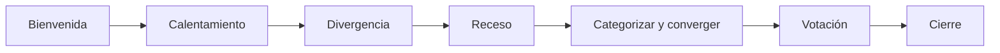

# Agenda de sesión de ideación

Proyecto: ___  Fecha: ___  Versión: borrador 1  Modo: taller en vivo / individual
Reto (`RET-nn`): ¿Cómo podemos ___?
Personas: ___  Duración total: ___ min  Quien facilita: ___  Quien lleva el tiempo: ___

## 1. Agenda (formato del libro)

| Tiempo | Actividad | Objetivos y reglas | Preguntas o comentarios | Encargados | Materiales necesarios |
|---|---|---|---|---|---|
| 10 min | Bienvenida y Principios de Participación | Acordar las reglas y repasar el reto y la evidencia | | | Reto impreso, hallazgos a la vista |
| 10 min | Rompehielo y calentamiento ("¿Cómo podríamos…?") | Activar la mente; construir sobre las ideas de otros | | | Hojas, marcadores |
| 25 min | Divergencia: técnica 1 (por ejemplo, 6-5-3) | Cantidad antes que calidad; cero censura | | | Hojas de 6-5-3, cronómetro |
| 10 min | Receso | Medir la energía; cambiar reglas o motivar si bajó | | | |
| 20 min | Divergencia: técnica 2 (por ejemplo, SCAMPER) | Otro ángulo sobre el mismo reto | | | Notas adhesivas |
| 20 min | Categorizar y converger | Agrupar, nombrar y reducir | | | Pared o tablero |
| 10 min | Votación | Priorizar los grupos más fuertes | | | Puntos o marcadores |
| 5 min | Cierre | Conclusiones y plan de acción | | | |

Ajusta tiempos al total disponible. Si falta tiempo, recorta primero la segunda técnica. Nunca el cierre ni la captura del banco de ideas.

## 2. Principios de Participación

- Las ideas se relacionan con los hallazgos, necesidades y tensiones de la empatía y la definición.
- Se hacen preguntas que respondan al reto.
- Cero censura: no hay ideas buenas ni malas.
- Todas las ideas son válidas; no se critica; se construye sobre las de los demás; no hay que enamorarse de la primera.
- Ideas con vida: Visibles, Implementables, Diferentes y Ambiciosas.
- Primero cantidad, sin pensar demasiado en viabilidad.

## 3. Evidencia a la vista

| ID | Hallazgo, necesidad o tensión | Procedencia |
|---|---|---|
| HAL-nn / NEC-nn / TEN-nn | | |

## 4. Roles

| Rol | Persona | Qué hace |
|---|---|---|
| Facilitación | | Dinámica de grupo y reglas |
| Tiempo | | Cronómetro y avisos |
| Captura | | Pasa las ideas al banco |
| Cuidado de participación | | Que todos hablen; manejo de conflictos |

## 5. Diagrama de la sesión

| Orden | Bloque | Tipo |
|---|---|---|
| 1 | Bienvenida | Preparar |
| 2 | Calentamiento | Preparar |
| 3 | Divergencia | Abrir |
| 4 | Receso | Energía |
| 5 | Categorizar y converger | Cerrar |
| 6 | Votación | Cerrar |
| 7 | Cierre | Cerrar |

## 6. Riesgos

| ID | Riesgo | Impacto | Mitigación |
|---|---|---|---|
| RIE-01 | | | |

## 7. Pendientes por validar

- ___
