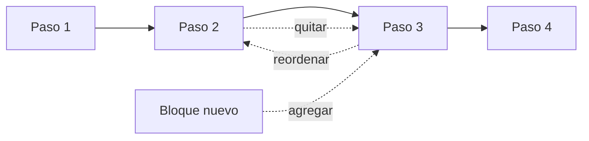

# Herramientas para facilitar la ideación

Nota de fuente: el libro (6.1) da el formato de la agenda, los Principios de Participación, las "ideas con vida", el calentamiento con preguntas "¿Cómo podríamos…?" y una definición breve de cada herramienta: Esquema del Proceso, Dramatización, Historieta, Sombreros, ¿Qué tal si…?, 6-5-3 (con sus pasos básicos) y SCAMPER (con sus siete verbos). También da la consigna "cero brain-storming, 100 % brain-writing" y el uso de la votación. Las preguntas de cada verbo SCAMPER, los pasos detallados de cada técnica, los tiempos sugeridos y la mecánica de la votación son una **adaptación** de los métodos publicados por sus autores originales (Alex Osborn y Bob Eberle para SCAMPER, Bernd Rohrbach para el brainwriting 6-3-5 y Edward de Bono para los sombreros) y no una transcripción del libro. El Anexo del libro (capítulo 10) solo trae índice: no tiene procedimiento de ideación.

Regla general (libro): sea cual sea la herramienta, al inicio importa la **cantidad**, sin pensar demasiado en viabilidad o pertinencia. Entre más ideas diferentes e inusuales, mejor.

Cómo anotar: cada idea es una frase corta con verbo, una por nota, con su `IDE-nn` y el `HAL-nn`, `NEC-nn` o `TEN-nn` al que responde.

## 0. Calentamiento con preguntas "¿Cómo podríamos…?"

**Para qué sirve (libro):** activar la mente antes de idear sobre el reto. El objetivo del facilitador es impulsar el pensamiento colectivo por medio de la conversación: escuchar y construir sobre las ideas de otros. Las preguntas son cortas, abren una discusión alrededor de un tema concreto y deben relacionarse con el problema que se acaba de definir.

**Ejemplos del libro:**
- ¿Cómo podríamos crear un cono de helado sin que el helado gotee o chorree?
- ¿Cómo podríamos rediseñar el cono de helado para que se pueda transportar más fácilmente?

**Cómo aplicarlo (adaptación, 5 a 10 minutos):**
1. Elegir una pregunta ligera, ajena al reto (como el cono de helado), para soltar el miedo a la hoja en blanco.
2. Dar 2 minutos de escritura individual y luego una ronda rápida: cada persona lee una idea y la siguiente construye sobre ella.
3. Lanzar una segunda pregunta ya ligada al reto, con la misma dinámica.
4. Cerrar con una frase: "ya calentamos, ahora vamos con el reto".

**Banco de calentamientos ficticios:**

| Tema | Pregunta |
|---|---|
| Ajeno al reto | ¿Cómo podríamos lograr que un paraguas no se lo lleve el viento? |
| Ajeno al reto | ¿Cómo podríamos hacer que esperar en una fila sea agradable? |
| Ligado a un reto de logística | ¿Cómo podríamos saber en qué estado va un paquete sin abrirlo? |
| Ligado a un reto de atención | ¿Cómo podríamos lograr que un cliente enojado se sienta escuchado en un minuto? |

## 1. Esquema del Proceso

**Para qué sirve (libro):** dibujar cada paso del proceso involucrado en el reto o en la solución en forma de bloques, y probar quitando o cambiando el orden de los bloques, agregando nuevos o mezclándolos.

**Cómo aplicarlo (adaptación):**
1. Escribir en bloques (una nota por paso) el proceso actual de principio a fin, desde la perspectiva de la persona del reto.
2. Marcar los pasos donde aparece la tensión o el dolor (`TEN-nn`).
3. Quitar un bloque a la vez y preguntar qué pasaría sin él; cada respuesta es una idea.
4. Cambiar el orden de dos bloques y anotar las ideas que surgen.
5. Agregar un bloque nuevo antes, después o en paralelo, y mezclar dos bloques en uno.
6. Registrar cada variante como `IDE-nn`.

| Movimiento | Qué se hace con los bloques |
|---|---|
| Quitar | Sacar un paso y ver qué pasa |
| Reordenar | Intercambiar el orden de dos pasos |
| Agregar | Insertar un paso nuevo |
| Mezclar | Unir dos pasos en uno |

## 2. Dramatización

**Para qué sirve (libro):** recrear o dramatizar la situación del reto o las soluciones y, literalmente, ponerse en los zapatos del usuario y empezar a improvisar.

**Cómo aplicarla (adaptación, 15 a 20 minutos):**
1. Elegir una escena concreta del Perfil del Cliente (la 1ra tarea o el 1er dolor).
2. Asignar papeles: la persona del reto, quien interactúa con ella y un par de observadores con papel y lápiz.
3. Improvisar la escena 3 minutos, sin guion y con los objetos a mano.
4. Repetirla cambiando una variable (otro lugar, otro ritmo, otra persona presente).
5. Los observadores escriben ideas y fricciones que vieron; el grupo las lee en voz alta.
6. Pasar las ideas al banco como `IDE-nn`.

En modo individual, se narra la escena en primera persona por escrito.

## 3. Historieta

**Para qué sirve (libro):** dibujar el contexto del reto o las posibles soluciones en forma de historieta, para comunicar con facilidad cómo se desarrolla el problema o cómo se usaría la solución.

**Cómo aplicarla (adaptación, 10 a 15 minutos):**
1. Dividir una hoja en 6 cuadros.
2. Cuadro 1: la persona y su situación; cuadro 2: el momento del dolor; cuadros 3 a 5: la solución imaginada en uso; cuadro 6: cómo termina la historia.
3. Dibujar con monos y palabras sueltas; no importa el dibujo.
4. Cada persona cuenta su historieta en 1 minuto; el grupo anota las ideas que contiene.
5. Cada historieta aporta una o varias `IDE-nn`; la historieta se guarda como evidencia de la idea.

## 4. Sombreros

**Para qué sirve (libro):** que cada miembro del equipo adopte un sombrero respecto a las soluciones propuestas: pesimista, optimista, analista de los datos, reverso, etc.

**Cómo aplicarlo (adaptación, 15 minutos):**
1. Tomar 3 a 5 ideas ya escritas.
2. Repartir sombreros: pesimista (qué podría salir mal), optimista (qué sería lo mejor), analista de los datos (qué evidencia hay), reverso (qué pasa si hacemos lo contrario).
3. Cada persona mira la misma idea durante 2 minutos desde su sombrero y escribe observaciones.
4. Rotar sombreros y repetir con otra idea.
5. Convertir cada observación en una idea nueva o variante (por ejemplo, el pesimista que dijo "se corta el aviso si no hay señal" aporta "aviso por varias vías"). Los comentarios del sombrero pesimista **no eliminan ideas** en esta etapa.

| Sombrero | Pregunta que lo activa |
|---|---|
| Pesimista | ¿Qué podría salir mal? |
| Optimista | ¿Qué sería lo mejor que podría pasar? |
| Analista de los datos | ¿Qué sabemos y qué no? |
| Reverso | ¿Y si hiciéramos lo contrario? |

## 5. ¿Qué tal si…?

**Para qué sirve (libro):** pensar cómo sería el escenario del reto sin una de las variables. Ejemplo del libro: si el reto es llegar más rápido de la casa a la oficina, se pregunta qué tal si no tuviera que ir a la oficina, o qué tal si no existieran oficinas.

**Cómo aplicarlo (adaptación, 10 minutos):**
1. Listar las variables del reto: personas, lugar, tiempo, dinero, reglas, objetos, tecnología.
2. Quitar una variable a la vez con "qué tal si no hubiera…" o "qué tal si no tuviéramos que…".
3. Escribir en 1 minuto todas las ideas que se vuelven posibles sin esa variable.
4. Pasar a la siguiente variable.
5. Para cada idea extrema, preguntar qué parte pequeña de ella se podría hacer hoy: ahí nace una idea implementable.

## 6. 6-5-3

**Para qué sirve (libro):** generar muchas ideas por escrito y en silencio, construyendo sobre las del compañero.

**Pasos del libro:**
1. Equipos de 6 personas.
2. Cada persona escribe en silencio 5 ideas en 3 minutos.
3. Pasados los 3 minutos, el papel se pasa a la persona de la derecha, que lee y construye sobre las ideas de su compañero anterior.
4. Se repite hasta dar la vuelta completa.
5. Al terminar, se leen y comparten todas las ideas con los demás.

**Detalles de adaptación:**
- Cada hoja lleva el reto arriba y 6 filas de 5 casillas; en cada ronda se llena una fila.
- Cálculo (propio, no del libro): 6 personas × 5 ideas × 6 rondas = hasta 180 ideas en unos 18 minutos, sin contar repeticiones. Con grupos más pequeños, se baja el número de rondas.
- La variante original del brainwriting (Rohrbach) es 6 personas, 3 ideas y 5 minutos; aquí se sigue la del libro.
- Quien facilita marca el tiempo y avisa "pasen la hoja". Si alguien se queda sin ideas, puede construir sobre una idea de la hoja que le llegó.
- Para equipos de menos de 6, usar el mismo método con el número de personas que haya.

## 7. SCAMPER

**Para qué sirve (libro):** tomar cada una de las características del reto que se está resolviendo y hacer con ella una de siete acciones.

**Cómo aplicarlo (adaptación, 20 a 30 minutos):**
1. Listar 3 a 5 características del reto o de una solución existente (quién, qué, cuándo, dónde, cómo).
2. Para cada característica, recorrer los siete verbos, un verbo a la vez, con 1 a 2 minutos de escritura por verbo.
3. Escribir cada idea como `IDE-nn` e indicar el verbo.
4. Si un verbo no da ideas, saltarlo: no se fuerza.

| Letra | Verbo | Pregunta disparadora (adaptación) |
|---|---|---|
| S | Sustituir | ¿Qué se puede cambiar por otra cosa: persona, material, canal, regla? |
| C | Combinar | ¿Qué se puede juntar con otra cosa: dos pasos, dos servicios, dos usos? |
| A | Adaptar | ¿Qué se parece a esto en otro sector o situación y qué podemos copiarle? |
| M | Magnificar | ¿Qué pasa si lo hacemos más grande, más frecuente o más visible? |
| P | Poner en otro uso | ¿Para quién más o para qué otra cosa serviría esto? |
| E | Eliminar | ¿Qué se puede quitar, simplificar o dejar sin hacer? |
| R | Reordenar | ¿Qué pasa si invertimos el orden o cambiamos quién empieza? |

## 8. Brain-writing: "cero brain-storming, 100 % brain-writing"

**Para qué sirve (libro):** pasar de nociones individuales a conceptos grupales: idear de forma individual, poner en común, agrupar, reducir, fortalecer y finalmente priorizar por medio de votación las soluciones o clusters más fuertes.

**Cómo aplicarlo (adaptación):**
1. **Idear de forma individual**: cada persona escribe sola, sin hablar, antes de cualquier conversación (3 a 5 minutos).
2. **Poner en común**: cada una lee sus ideas; no se critica ni se explica de más.
3. **Agrupar**: las notas parecidas se juntan y se nombra el grupo (el libro sugiere categorías que engloben la naturaleza de las ideas; ejemplo: varias ideas de programas educativos o entrenamiento van bajo "Educación").
4. **Reducir**: se unen duplicadas.
5. **Fortalecer**: se mejoran las más prometedoras (trabajo de `construir-concepto-fuerte`).
6. **Priorizar** por votación.

Por qué en silencio: evita que hable primero quien más voz tiene, protege a los introvertidos y reduce el anclaje en la primera idea.

## 9. Votación

**Para qué sirve (libro):** herramienta democrática cuando el equipo tiene problemas para llegar a un consenso a tiempo, y manera de priorizar los clusters más fuertes.

**Cómo aplicarla (adaptación, 5 a 10 minutos):**
1. Dejar visibles los grupos de ideas, cada uno con su nombre.
2. Dar a cada persona 3 votos (puntos o marcas). Regla práctica: más o menos un voto por cada 4 a 5 grupos, mínimo 3.
3. Votar en silencio y a la vez, para que nadie vote por imitación. Se puede poner más de un voto en el mismo grupo.
4. Contar y registrar los votos en `assets/banco-de-ideas.md`.
5. Leer los resultados en voz alta; si hay empate, desempatar con una pregunta: "¿cuál responde más directamente al reto?".
6. Los grupos más votados pasan a `construir-concepto-fuerte`; los demás se guardan, no se borran.

La votación **prioriza**, no decide: la decisión final es de quien tiene la autoridad (`DEC-nn`).
