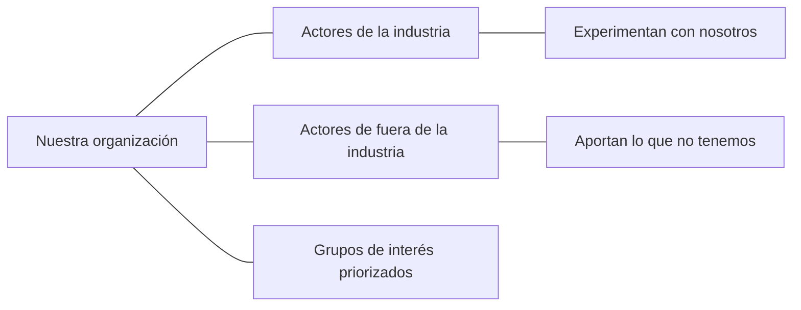

# Mapa de ecosistema

Organización: ___  Fecha: ___  Versión: borrador 1
Reto o solución de referencia (`RET-nn` o `CON-nn`): ___
Regla: los actores los nombra la persona. Si no sabe quién, se anota el tipo de actor y queda Pendiente por validar. Ningún acuerdo se da por hecho.

## 1. Propósito de abrirse (confirmado por la persona)

| Campo | Contenido | Procedencia |
|---|---|---|
| Qué se quiere lograr abriéndose | | Dicho por participante |
| Lenguaje común: qué significa innovar aquí (una frase) | | |
| Empezar desde adentro: retos o proyectos internos entre áreas hoy | | |

## 2. Activos y necesidades

| ID | Tipo | Descripción | ¿Se cubre por dentro? | Procedencia |
|---|---|---|---|---|
| ACT-01 | Activo estratégico (difícil de imitar) | | | |
| | Activo oculto (ya se posee, valor sin apreciar) | | | |
| CAP-01 | Necesidad (vacío que impide crear valor) | | No / Parcial / Sí | |

Necesidad elegida para abrir (decisión de la persona, `DEC-nn`): ___

## 3. Grupos de interés y canales

El libro indica que casi toda empresa tiene 8 perfiles o más, y que en innovación abierta no conviene trabajar con más de 3 a la vez.

| # | Grupo de interés | Qué aporta o necesita | Canal de comunicación | Prioridad (hasta 3, decide la persona) |
|---|---|---|---|---|
| 1 | | | | |
| 2 | | | | |
| 3 | | | | |
| 4 | | | | En espera |

## 4. Ecosistema

| Zona | Quiénes (nombrados por la persona) | Qué se busca de ellos | Estado |
|---|---|---|---|
| Industria | | Que experimenten con nosotros | Pendiente por validar |
| Fuera de la industria | | Aportes que no tenemos | Pendiente por validar |
| Grupos priorizados | | | |

## 5. Patrones de innovación aplicados

| Patrón | Pregunta | Respuesta | Procedencia |
|---|---|---|---|
| (elige 2 o 3: Adyacencias Posibles, Redes Líquidas, Corazonada Lenta, Serendipia, Error, Exaptación, Plataformas) | | | Supuesto |

## 6. Perfil de solucionadores y criterios de selección

| Campo | Contenido |
|---|---|
| Capacidades que debe tener quien aporte | |
| Qué tipo de actor es (empresa, universidad, persona experta, comunidad) | |
| Criterios de selección (la persona decide) | |
| Cómo se les invita (canal y mensaje) | |

## 7. Nuevas habilidades que faltan en el equipo

| Habilidad (holística, manejo de conflictos, optimismo, curiosidad, tolerancia a la incertidumbre, aprender rápido, networking, comunicación) | Quién la tiene hoy | Cómo se fomenta |
|---|---|---|
| | | |

## 8. Riesgos y pendientes por validar

| ID | Riesgo | Impacto | Mitigación |
|---|---|---|---|
| RIE-01 | | | |

- Pendiente por validar: ___
- Lista de calidad: hay propósito confirmado; la necesidad no se cubre por dentro; no más de 3 grupos a la vez; ningún actor ni acuerdo se da por hecho; las reglas de colaboración existen.
- Siguiente paso: completar `reglas-de-colaboracion.md`.
