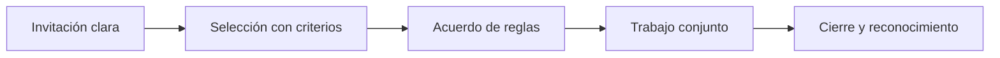

# Reglas de colaboración

Organización: ___  Fecha: ___  Versión: borrador 1
Iniciativa o reto: ___  Partes: ___
Aviso: este documento es una base de conversación, no asesoría legal. Debe revisarlo un abogado antes de firmar o compartir información confidencial.
El libro pide comunicar con claridad la propiedad intelectual, las responsabilidades de cada equipo y qué se está buscando, para no incurrir en problemas legales o de resultado.

## 1. Qué se busca

| Campo | Contenido |
|---|---|
| Reto o necesidad (`RET-nn`, `CAP-nn`) | |
| Qué se espera obtener | |
| Qué NO se pide | |
| Fecha de inicio y de cierre | |

## 2. Propiedad intelectual

| Tema | Acuerdo (lo decide la persona) | Estado |
|---|---|---|
| Qué es de cada parte antes de empezar | | |
| De quién es lo que se cree entre las partes | | |
| Qué información confidencial se comparte y cómo se protege | | |
| Qué puede publicar cada parte | | |

## 3. Responsabilidades

| Parte | Qué hace | Qué entrega | Para cuándo |
|---|---|---|---|
| | | | |

## 4. Incentivos

| Quién aporta | Qué recibe | Cuándo |
|---|---|---|
| | | |

## 5. Comunicación

| Tema | Acuerdo |
|---|---|
| Canal principal | |
| Frecuencia de seguimiento | |
| Quién decide cuando hay desacuerdo | |
| Cómo se comunican los cambios | |

## 6. Selección, salida y cierre

| Tema | Acuerdo |
|---|---|
| Criterios de selección de quien participa | |
| Cómo puede una parte retirarse | |
| Qué pasa con lo avanzado si termina antes | |
| Cómo se cierra y se reconoce el aporte | |

| Etapa | Qué debe quedar escrito |
|---|---|
| Invitación | Qué se busca y qué no |
| Selección | Criterios |
| Acuerdo | Propiedad intelectual, responsabilidades, incentivos |
| Trabajo | Comunicación y seguimiento |
| Cierre | Salida y reconocimiento |

## 7. Riesgos y pendientes

| ID | Riesgo | Impacto | Mitigación |
|---|---|---|---|
| RIE-01 | | | |

- Pendiente por validar con un abogado: ___
