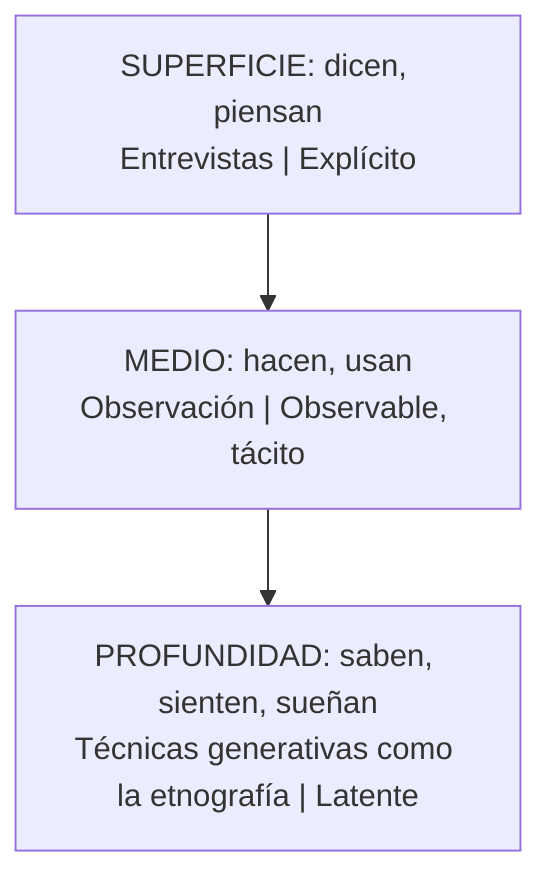

# Plan de investigación de empatía

Proyecto: ___  Fecha: ___  Versión: borrador 1
Reto inicial: `RET-01` ¿Cómo podemos ___? (hipótesis por validar)

## 1. Objetivo y preguntas de investigación

Objetivo: entender ___ (comportamiento, decisiones, contexto) de ___ (quiénes) para saber si el reto es el correcto.

| ID | Pregunta de investigación | Supuesto que prueba | Procedencia del supuesto |
|---|---|---|---|
| PRU-01 | | SUP-01 | Dicho por participante / Supuesto |

## 2. A quién escuchar

Detalle en `perfil-de-usuario.md`. Resumen: ___ personas de ___ (perfil), incluyendo a quien ya no es cliente o nunca lo fue: ___

## 3. Técnica elegida (escalera de profundidad)

| Nivel | Lo que las personas… | Técnicas | Conocimiento | ¿Se usa? | Por qué |
|---|---|---|---|---|---|
| Superficie | Dicen, piensan | Entrevistas | Explícito | sí / no | |
| Medio | Hacen, usan | Observación | Observable, tácito | sí / no | |
| Profundidad | Saben, sienten, sueñan | Técnicas generativas como la etnografía (diario, sesión participativa, collage, mapa mental) | Latente | sí / no | |

La tabla de arriba es la versión equivalente del diagrama.

## 4. Muestra, lugares y calendario

| # | Persona o grupo | Técnica | Dónde | Cuándo | Responsable | Consentimiento para grabar o fotografiar |
|---|---|---|---|---|---|---|
| 1 | | | | | | sí / no |

Cantidad prevista: ___ (parar cuando las historias empiecen a repetirse). Materiales: ___ (grabadora o cuaderno, guía, cámara si hay permiso).

## 5. Registro de evidencia

| ID | Qué se vio o se oyó (sin interpretar) | Fuente (persona o lugar) | Tipo (dicho / hecho observado / dato) | Procedencia | Interpretación (aparte, marcada como Inferencia de la IA o Supuesto) |
|---|---|---|---|---|---|
| HAL-01 | | | | Dicho por participante / Observación del facilitador / Evidencia | |

## 6. Contradicciones (lo que dicen frente a lo que hacen)

| ID | Dicen | Hacen | Por qué importa | Pendiente por validar |
|---|---|---|---|---|
| HAL-02 | | | | |

## 7. Preguntas abiertas y vacíos

- ___

## 8. Riesgos

| ID | Riesgo | Impacto | Mitigación |
|---|---|---|---|
| RIE-01 | Entrevistar solo a clientes fieles | Sesgo: se pierde la voz de quien se fue | Incluir a ex clientes y a no clientes |

## 9. ¿Alcanza la evidencia?

- Las historias ya se repiten: sí / no
- Hay contraste entre dicen y hacen: sí / no
- Decisión: otra ronda / pasar a `sintetizar-y-redefinir-reto` (`DEC-01`)
