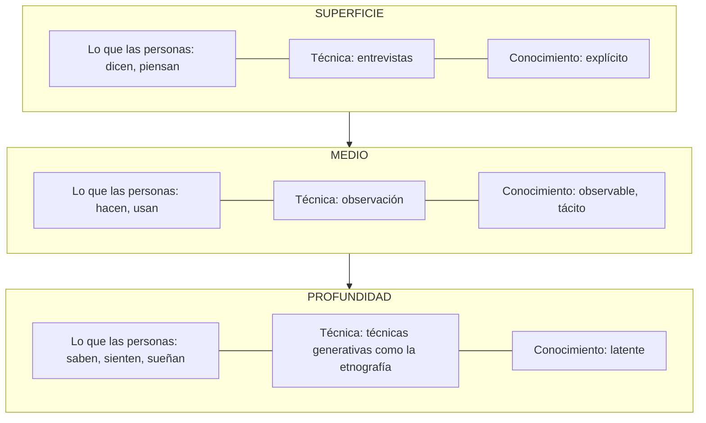

# Herramientas para investigar y empatizar

Nota de fuente: el libro (4.1.2) nombra las herramientas aplicables (Perfil de Usuario, Entrevistas a Profundidad, Diario de Usuario, Sesión Participativa, Collage y Mapa Mental), explica que la elección depende de qué tan profundo se quiera conocer la experiencia del usuario y reproduce la escalera de profundidad (Sleeswijk Visser et al., 2005). Del Anexo (10.4 Entrevistas, 10.5 Collage, 10.6 Mapa Mental, 10.7 Diario de Usuario, 10.8 Perfil de Usuario y 10.11 Sesión Participativa) el libro solo da los nombres y las definiciones: esas secciones no traen texto de procedimiento. Los pasos que siguen son una **adaptación** de métodos publicados de investigación centrada en las personas (entrevistas cualitativas, estudios de diario, investigación generativa) y no una transcripción del libro.

Una observación sobre el libro: el texto asocia "observación etnográfica" con lo que la gente hace y "sesiones participativas" con lo que sabe, siente o sueña; la figura que lo acompaña pone la observación en el nivel medio y las técnicas generativas como la etnografía en la profundidad. Aquí se sigue la figura y se tratan diario, sesión participativa, collage y mapa mental como técnicas generativas.

## La escalera de profundidad

| Nivel | Lo que las personas… | Técnicas | Conocimiento |
|---|---|---|---|
| Superficie | Dicen, piensan | Entrevistas | Explícito |
| Medio | Hacen, usan | Observación | Observable, tácito |
| Profundidad | Saben, sienten, sueñan | Técnicas generativas como la etnografía | Latente |

Cada fila del diagrama equivale a una fila de la tabla. Fuente de la escalera: Sleeswijk Visser et al., 2005, tal como la cita el libro.

**Cómo elegir (adaptación):**

| Si necesitas… | Empieza por | Añade |
|---|---|---|
| Saber qué piensa la gente de un tema y cómo cuenta su historia | Entrevistas a profundidad | Perfil de Usuario |
| Contrastar lo que dicen con lo que hacen | Observación (acompañar la tarea en su lugar real) | Entrevista corta en el sitio |
| Entender hábitos distribuidos en el tiempo | Diario de Usuario | Entrevista de cierre |
| Descubrir emociones, aspiraciones y lo que nadie sabe explicar | Sesión Participativa con Collage o Mapa Mental | Entrevista previa |

Regla: combina al menos dos niveles cuando el reto sea importante; una sola técnica da una sola mirada.

## 1. Perfil de Usuario (Anexo 10.8)

**Para qué sirve:** definir a quién se va a investigar, de modo que la muestra tenga sentido para el reto. Por ejemplo, si la marca del reto tiene un enfoque juvenil, el perfil se acota por edad y por el momento de uso.

**Cómo aplicarlo:**
1. Partir del reto y de sus actores (`identificar-reto`).
2. Describir el perfil con `assets/perfil-de-usuario.md`: rol, contexto, relación con el problema y con la empresa.
3. Elegir variedad: usuarios típicos, extremos y quien se fue o nunca compró.
4. Escribir criterios para incluir y excluir.
5. Tratarlo como hipótesis y ajustarlo después de las primeras conversaciones.

Error común: entrevistar a las personas más fáciles de alcanzar (amigos, clientes fieles) y concluir que "todos lo ven así".

## 2. Entrevistas a Profundidad (Anexo 10.4)

**Para qué sirve:** comprender lo que las personas dicen y piensan sobre su experiencia, en su propio lenguaje. Es el nivel de superficie de la escalera: conocimiento explícito.

**Cómo aplicarlas:**
1. **Antes:** definir objetivo, a quién y qué se necesita aprender; preparar preguntas abiertas con `assets/guia-de-entrevista.md`; ensayar con un compañero.
2. **Durante:** pedir una historia reciente y concreta; preguntar "¿por qué?" y "¿puedes darme un ejemplo?"; hablar poco (regla 80/20: la persona habla el 80 %); verificar la interpretación ("si entendí bien..."); anotar comportamientos, no solo palabras.
3. **Después:** pasar las notas en limpio en las siguientes 24 horas, separar observación de interpretación y registrar cada dato como `HAL-nn`.

| Evitar | Mejor |
|---|---|
| "¿Te gustaría una app para esto?" (pregunta que sugiere la respuesta) | "Cuéntame la última vez que tuviste que hacer esto" |
| "¿Qué opinas del servicio?" (opinión general) | "¿Qué pasó la última vez que lo usaste?" |
| Resolver el problema del entrevistado en la sesión | Escuchar, anotar y agradecer |

Cuántas: lo suficiente para que las historias empiecen a repetirse; para un primer ciclo de empatía, de 5 a 8 personas por perfil suele alcanzar (es una guía práctica, no una regla del libro).

## 3. Observación (nivel medio de la escalera)

**Para qué sirve:** ver lo que la gente hace y usa, incluido el conocimiento tácito que no sabe explicar. Es la base de la observación etnográfica que menciona el libro.

**Cómo aplicarla (adaptación):**
1. Elegir un momento y un lugar donde ocurra el problema (un puesto de trabajo, una cocina, un muelle).
2. Pedir permiso; acompañar sin interrumpir; si hace falta, preguntar "¿me muestras cómo lo haces?".
3. Anotar en tres columnas: qué hace la persona, qué usa o dónde improvisa, qué emoción se nota. Fotos solo con permiso y sin rostros.
4. Marcar los atajos, los trucos propios y las esperas: son pistas de dolores.
5. Contrastar con lo que dijo en la entrevista: ahí aparecen las contradicciones dicen/hacen.

## 4. Diario de Usuario (Anexo 10.7)

**Para qué sirve:** observar experiencias distribuidas en el tiempo, que no se recuerdan bien en una entrevista. Es una técnica generativa: la persona produce el material.

**Cómo aplicarlo:**
1. Elegir 3 a 5 personas del perfil y una duración de 3 a 7 días.
2. Entregar `assets/diario-de-usuario.md` con una carta clara de por qué y para qué.
3. Pedir registros breves en el momento (texto, foto o dibujo). Un mensaje de recordatorio a mitad del período ayuda.
4. Al recoger, hacer una conversación de 15 a 20 minutos sobre las entradas dudosas.
5. Registrar los datos como `HAL-nn` (Dicho por participante) y buscar patrones de hora, lugar y emoción.

## 5. Sesión Participativa (Anexo 10.11)

**Para qué sirve:** que un grupo pequeño de personas del perfil construya y converse sobre su experiencia con ejercicios guiados, para llegar a lo que saben, sienten o sueñan (nivel de profundidad). El libro menciona una sesión participativa junto con un diario de usuario para generar material gráfico de inspiración.

**Cómo aplicarla (adaptación):**
1. Convocar de 4 a 8 personas del perfil; 90 a 120 minutos; un facilitador y alguien que tome nota.
2. Principios de participación: todas las voces valen, no se juzga, se habla desde la experiencia propia.
3. Estructura: calentamiento (10 min) → ejercicio principal con Collage o Mapa Mental (45 a 60 min) → cada persona explica su obra (20 a 30 min) → cierre y agradecimiento.
4. Preguntas para explicar la obra: "¿Qué quisiste mostrar? ¿Por qué elegiste esta imagen?".
5. Fotografiar las obras (con permiso) y registrar las explicaciones, no solo las imágenes.

## 6. Collage (Anexo 10.5)

**Para qué sirve:** expresar emociones y aspiraciones con imágenes cuando las palabras no alcanzan; sintetiza información emocional.

**Cómo aplicarlo:**
1. Dar una consigna abierta ("Muestra cómo te sientes cuando ___" o "Cómo sería el día ideal con ___").
2. Poner a disposición revistas, imágenes impresas, tijeras, pegante y papel grande; 20 a 30 minutos para armar.
3. Pedir que cada persona cuente su collage; anotar las palabras exactas.
4. Buscar los elementos repetidos entre collages (colores, personas, objetos, emociones).

## 7. Mapa Mental (Anexo 10.6)

**Para qué sirve:** relacionar conceptos y subproblemas; ver cómo organiza la persona su mundo alrededor del tema.

**Cómo aplicarlo:**
1. Escribir el tema en el centro de una hoja grande.
2. Pedir ramas con las ideas, personas, lugares o momentos que la persona asocia; sub-ramas para los detalles.
3. Preguntar por las conexiones inesperadas y por lo que falta.
4. Fotografiar y anotar las explicaciones; comparar con los mapas de otras personas.

## Registrar lo que se encuentra

Cada observación va a `assets/plan-de-investigacion.md` (sección 5) con ID `HAL-nn`, la fuente y su procedencia. Reglas:

- Una fila por dato; el dato en las palabras de la persona cuando sea posible.
- La interpretación va en otra columna, marcada como **Inferencia de la IA** o **Supuesto**.
- Si alguien contradice lo que otra persona dijo o lo que se observó, va a la sección 6 (contradicciones).
- Nada de nombres reales de personas: alias o códigos.
