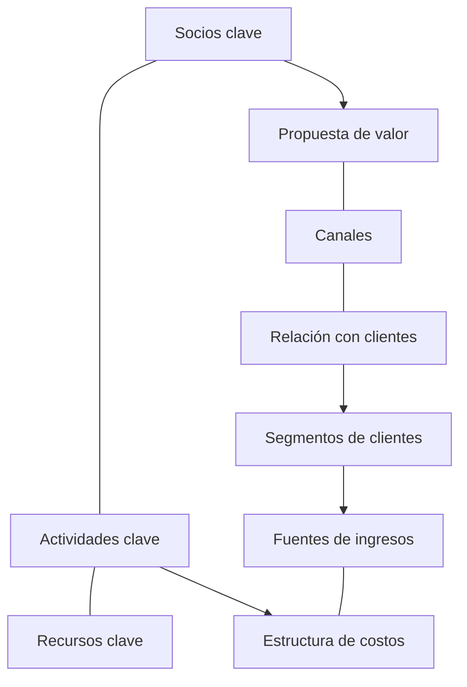

# Lienzo de Modelo de Negocio (versión completa para escalar)

Proyecto: ___  Fecha: ___  Versión: borrador 1
Solución o concepto (`CON-nn`): ___
Para analizar el modelo de una empresa que ya existe y encontrar retos, usa el lienzo de `identificar-reto`; este sirve para consolidar el modelo de una solución con evidencia y decidir cómo escalarla.
Etiqueta por defecto: lo dicho sin respaldo es Supuesto. Un bloque es **Hecho** solo si tiene evidencia (`PRU-nn`, `HAL-nn` o un registro).

## 1. Los 9 bloques

Orden: segmento y propuesta de valor (ya existen), luego un bloque por turno.

| # | Bloque | Contenido | Evidencia | Estado (Hecho / Supuesto / Pendiente por validar) |
|---|---|---|---|---|
| 1 | Segmentos de clientes (del Perfil del Cliente) | | | |
| 2 | Propuesta de valor (del Mapa de Valor) | | | |
| 3 | Canales | | | |
| 4 | Relación con clientes | | | |
| 5 | Fuentes de ingresos | | | |
| 6 | Actividades clave | | | |
| 7 | Recursos clave | | | |
| 8 | Socios clave | | | |
| 9 | Estructura de costos | | | |

## 2. Diagrama

La tabla de la sección 1 es el equivalente del diagrama.

## 3. Business Model Fit

| Criterio | Evidencia | Estado | Procedencia |
|---|---|---|---|
| Repetible (otros clientes sin empezar de cero) | | | |
| Rentable (ingreso por cliente mayor que costo de atender y adquirir) | | | |
| Escalable (el costo crece menos que el ingreso) | | | |

## 4. Economía básica (solo con números de la persona)

| Concepto | Valor | Estado (Hecho / Supuesto) | Procedencia |
|---|---|---|---|
| Ingreso por cliente | | | |
| Costo de atender a un cliente | | | |
| Costo de conseguir un cliente | | | |
| Margen por cliente (ingreso menos costos) | | | Cálculo de la IA con los datos anteriores |

No inventes cifras. Un número sin respaldo es Supuesto.

## 5. Hipótesis pendientes (priorizadas por la persona)

| ID | Hipótesis (bloque al que pertenece) | Si no es como creemos | Prioridad (decisión de la persona) | Cómo se prueba |
|---|---|---|---|---|
| SUP-01 | | Hace inviable el modelo / se corrige con poco | | Piloto / prueba |

## 6. Variante Lean Canvas (opcional, adaptación)

Solo si la persona está en una fase muy temprana y prefiere ese formato: se usa para las primeras validaciones y se vuelve a estos nueve bloques cuando hay clientes que pagan.

## 7. Riesgos y pendientes por validar

| ID | Riesgo | Impacto | Mitigación |
|---|---|---|---|
| RIE-01 | | | |

- Pendiente por validar: ___
- Lista de calidad: cada bloque tiene estado; ningún número sin procedencia; el Business Model Fit no se declara sin evidencia.
