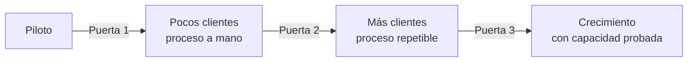

# Plan de piloto y ruta de escalamiento

Proyecto: ___  Fecha: ___  Versión: borrador 1
Modelo de negocio de referencia: `lienzo-modelo-de-negocio.md`
Regla: el piloto valida la mayor cantidad posible de hipótesis, empezando por las más riesgosas (las que, si no son como creemos, hacen inviable el modelo). La métrica de éxito se escribe antes de ejecutar.

## 1. Qué se valida

| Hipótesis (`SUP-nn`) | Bloque del lienzo | Por qué es riesgosa | Decisión de priorizar (`DEC-nn`) |
|---|---|---|---|
| | | | |

## 2. Diseño del piloto

| Campo | Contenido |
|---|---|
| Alcance (cuántos clientes, qué segmento) | |
| Duración y fechas | |
| Qué se entrega (la propuesta, en su forma más simple) | |
| Recursos necesarios y costo aproximado | |
| Responsables | |
| Qué se mide (métricas del Tablero de Validación) | |
| Métrica de éxito (número y umbral, antes de ejecutar) | |
| Regla de decisión (qué se hace si no se alcanza) | |

## 3. Riesgos del piloto

| ID | Riesgo | Impacto | Mitigación |
|---|---|---|---|
| RIE-01 | | | |

## 4. Ruta de escalamiento progresivo

Cada puerta es una decisión de la persona y depende de un resultado, no de una fecha.

| Etapa | Qué se hace | Condición para pasar a la siguiente (evidencia) | Decisión (`DEC-nn`) |
|---|---|---|---|
| Piloto | Validar las hipótesis más riesgosas | Métrica de éxito alcanzada | |
| Pocos clientes | Entregar a mano, afinar el proceso | Repetible con el mismo proceso | |
| Más clientes | Estandarizar y medir costos reales | Margen por cliente positivo con datos reales | |
| Crecimiento | Aumentar capacidad | Capacidad operativa probada | |

## 5. Capacidad operativa

| Pregunta | Respuesta | Estado |
|---|---|---|
| ¿Qué se puede entregar hoy con los recursos actuales? | | |
| ¿Qué cuello de botella aparecería primero? | | |
| ¿Qué habría que sumar para atender diez veces más? | | |

## 6. Siguiente paso

- Ejecutar el piloto y registrar los resultados en `probar-y-aprender`.
- Pendiente por validar: ___
