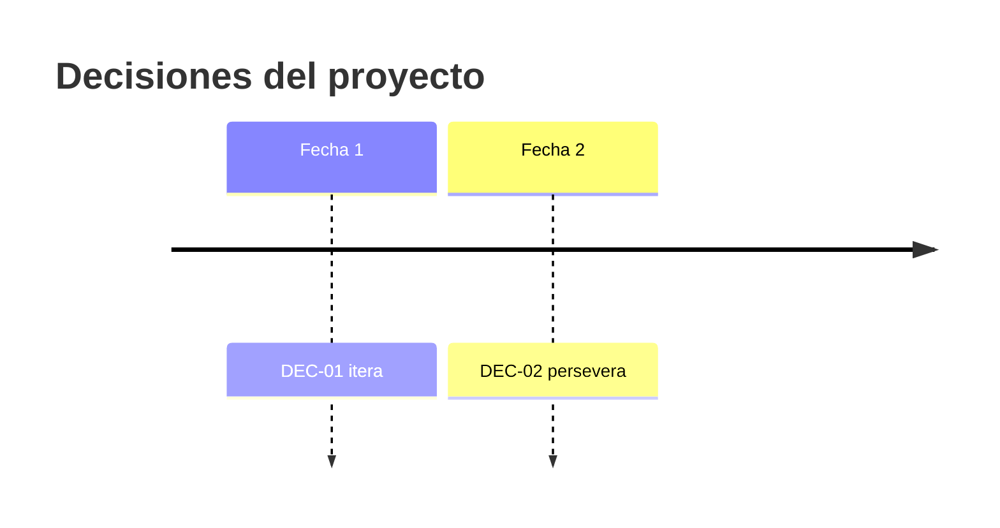

# Bitácora de decisiones

Proyecto: ___  Fecha de inicio: ___
Regla: la decisión la toma la persona con autoridad; la IA propone el orden de los hechos, no la decisión. Un `DEC-nn` no se reutiliza aunque se revierta (se registra una decisión nueva que lo reemplaza).

Cuatro salidas posibles:

| Salida | Significa | Cuándo suele aplicar |
|---|---|---|
| Perseverar | Seguir con el modelo como está y probar la siguiente hipótesis | Se cumplió la meta |
| Iterar | Ajustar la solución o la prueba y repetir | Cerca de la meta, o se entiende qué ajustar |
| Pivotar | Cambiar el problema, el segmento, la solución o el modelo | Lejos de la meta y se entiende por qué |
| Detener | Parar y guardar lo aprendido | Lejos de la meta, sin camino de mejora |

## Registro

| ID | Fecha | Prueba y resultado (Hecho) | Meta | Decisión (salida) | Razón dada por la persona | Decidió | Siguiente paso | Estado |
|---|---|---|---|---|---|---|---|---|
| DEC-01 | | `PRU-nn`: | | | | | | Vigente |

## Línea de tiempo (equivalente en tabla del diagrama)

| Fecha | Decisión | Salida |
|---|---|---|
| | `DEC-01` | |

## Decisiones revertidas o reemplazadas

| ID anterior | Nuevo ID | Qué cambió | Razón |
|---|---|---|---|
| | | | |

## Pendientes por validar

- ___
