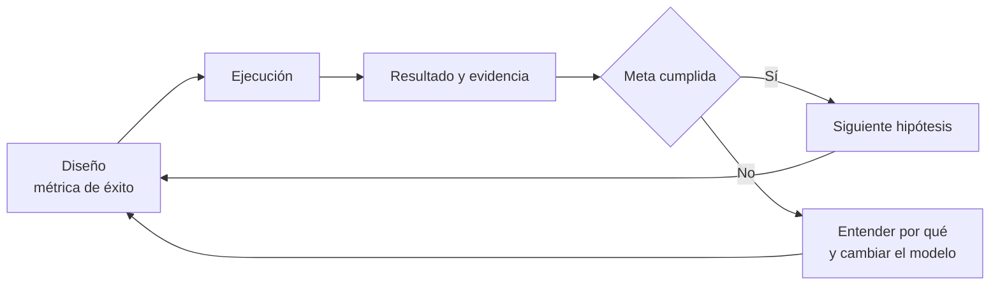

# Tablero de Validación

Proyecto: ___  Fecha: ___  Versión: borrador 1
Solución o concepto (`CON-nn`): ___
Regla: la métrica de éxito se escribe **antes** de ejecutar la prueba. Si se escribió después de ver el resultado, márcalo en la columna "Meta fijada" como "Después" (Observación del facilitador).

## 1. Momento 1: diseño de la prueba

Las primeras pruebas se enfocan en las hipótesis más riesgosas.

| Prueba (`PRU-nn`) | Supuesto (`SUP-nn`) | Riesgo (alto, medio, bajo) | Experimento | Muestra | Métrica de éxito (número y umbral) | Meta fijada (Antes / Después) |
|---|---|---|---|---|---|---|
| PRU-01 | SUP-01 | | | | | Antes |

Ejemplo de métrica de éxito (libro, 8.1.2): si voy donde 100 clientes, al menos 50 deben comprarme.

## 2. Momento 2: resultado, aprendizaje y decisión

| Prueba | Resultado (número) | Participantes reales | Evidencia (dónde está el registro) | ¿Se cumplió la meta? (Hecho: resultado frente a umbral) | Explicación de la persona (Supuesto) | Aprendizaje | Decisión (`DEC-nn`) | Próximo paso |
|---|---|---|---|---|---|---|---|---|
| PRU-01 | | | | | | | | |

Si la meta se cumple, se sigue con la siguiente hipótesis. Si no, se entiende por qué y se cambia el modelo. El ejercicio es cíclico.

| Paso | Resultado | Siguiente |
|---|---|---|
| Meta cumplida | Se sigue validando | Siguiente hipótesis riesgosa |
| Meta no cumplida | Se aprende por qué | Cambiar el modelo y volver a diseñar |

## 3. Las seis métricas de evaluación

Se completan cuando ya hay varias pruebas. Estado: Verde (hay datos y favorecen), Amarillo (hay datos y no concluyen), Rojo (hay datos y no favorecen) o Sin datos (Pendiente por validar).

| Métrica | Pregunta guía | Dato o evidencia | Estado | Procedencia |
|---|---|---|---|---|
| Afinidad Estratégica | ¿Qué tan alineada está la idea con la estrategia y los objetivos? | | | |
| Encaje Problema/Solución | ¿Hay un problema que vale la pena resolver y un concepto que lo resuelva? | | | |
| Tracción | ¿Cuántos clientes que pagan se han descubierto y atraído? | | | |
| KPI | ¿Cuánto cuesta adquirir y retener un cliente; hay referidos y monetización? | | | |
| Viabilidad Económica | ¿La prueba ácida de costos frente a ingresos da positivo? | | | |
| Encaje Producto/Mercado | ¿Genera valor al cliente, captura valor y es repetible y escalable? | | | |

## 4. Lectura

- Prueba(s) más recientes y su decisión: ___
- Métricas con estado Rojo o Sin datos: ___
- Hipótesis riesgosa siguiente: ___

## 5. Riesgos y pendientes por validar

| ID | Riesgo | Impacto | Mitigación |
|---|---|---|---|
| RIE-01 | | | |

- Pendiente por validar: ___
- Lista de calidad: cada prueba tiene métrica de éxito antes de ejecutar; cada resultado tiene evidencia; la comparación con la meta es un hecho y la interpretación es un supuesto; cada decisión tiene `DEC-nn` y razón.
