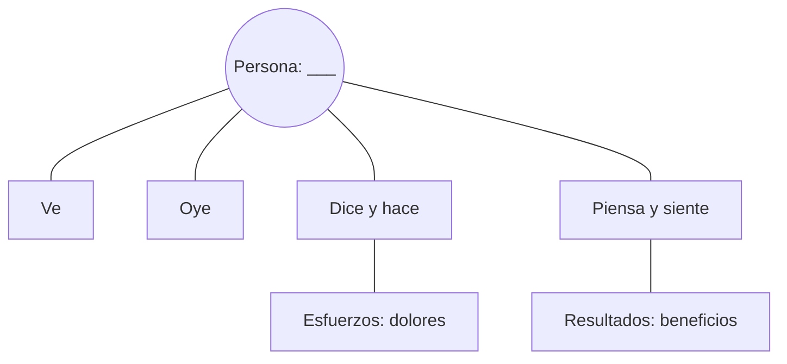

# Mapa de Empatía

Perfil: ___ (a quién corresponde)  Fecha: ___  Versión: borrador 1
Basado en: personas escuchadas ___ (de las `HAL-nn` que citan abajo)

Una persona o un perfil por mapa. Cada nota cita su evidencia; lo que no tenga evidencia va marcado como Supuesto.

| Cuadrante | Qué anotar | Notas (con `HAL-nn`) | Procedencia |
|---|---|---|---|
| Ve | Lo que ve en su entorno, quién y qué lo rodea | | |
| Oye | Lo que oye de colegas, clientes, medios | | |
| Dice y hace | Lo que dice en público y cómo se comporta (¿coincide?) | | |
| Piensa y siente | Lo que le preocupa, lo que le ilusiona, lo que no dice en voz alta | | |
| Esfuerzos (dolores) | Miedos, frustraciones y obstáculos | | |
| Resultados (beneficios) | Lo que quiere lograr, cómo mide el éxito | | |

Los seis cuadrantes del diagrama son los de la tabla.

## Tensiones visibles

- Entre lo que dice y lo que hace: ___ (`HAL-nn`)
- Entre lo que piensa y lo que siente: ___

## Lo que no sabemos (Pendiente por validar)

- ___
