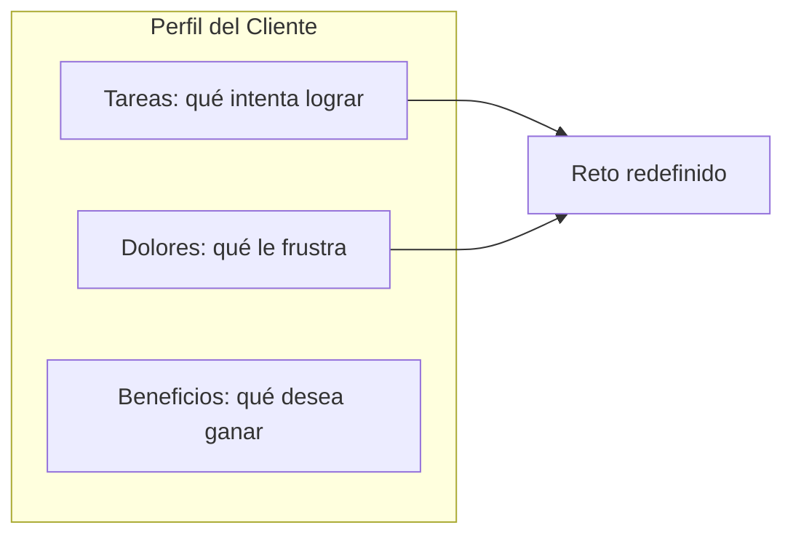

# Perfil del Cliente

Segmento o perfil: ___  Fecha: ___  Versión: borrador 1
Fuente: síntesis de la investigación de empatía (`sintesis.md`)

Ordena cada lista de más a menos importante; el primer ítem es el que se usa para reformular el reto. Cada ítem cita su evidencia.

## Tareas del cliente (lo que intenta lograr)

| Orden | ID | Tarea | Tipo (funcional / social / emocional) | Evidencia (`HAL-nn`) | Importancia (alta / media / baja) |
|---|---|---|---|---|---|
| 1ra | HAL-nn | | | | |
| 2da | | | | | |

## Dolores (frustraciones, obstáculos, riesgos que teme)

| Orden | ID | Dolor | Durante qué tarea | Evidencia (`HAL-nn`) | Intensidad (alta / media / baja) |
|---|---|---|---|---|---|
| 1er | TEN-01 | | | | |
| 2do | | | | | |

## Beneficios (resultados y ventajas que desearía o le sorprenderían)

| Orden | ID | Beneficio | Tipo (necesario / esperado / deseado / inesperado) | Evidencia (`HAL-nn`) | Relevancia |
|---|---|---|---|---|---|
| 1ro | NEC-01 | | | | |

Equivalente en tabla: Tareas, Dolores y Beneficios forman el Perfil del Cliente; de la 1ra tarea y el 1er dolor sale el reto redefinido.

## Qué queda como supuesto

| ID | Supuesto | Prueba asociada |
|---|---|---|
| SUP-nn | | Pendiente por validar |

El Mapa de Valor (cómo responde nuestra oferta a este perfil) se trabaja después, en la etapa de prototipar.
