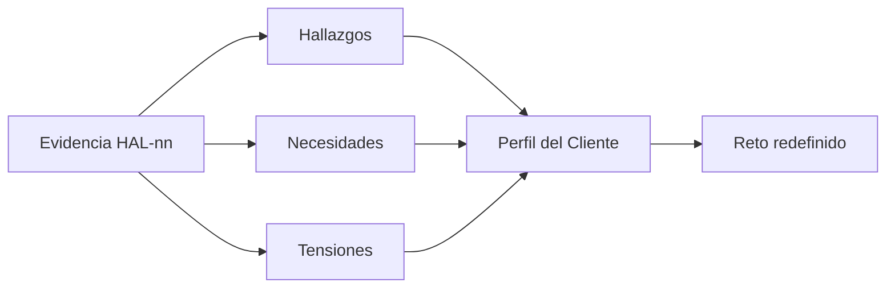

# Síntesis de la investigación de empatía

Proyecto: ___  Fecha: ___  Versión: borrador 1
Reto inicial: `RET-01` ¿Cómo podemos ___? (hipótesis)
Base de evidencia: ___ entrevistas, ___ observaciones, ___ diarios o sesiones (procedencia de cada dato en la tabla)

## 1. Clasificación

- **Hallazgos**: cosas que no conocíamos sobre el segmento y que entendimos en la fase de empatía.
- **Necesidades**: lo que el segmento quiere suplir o satisfacer en el contexto del reto.
- **Tensiones**: obstáculos o problemas que enfrenta al salir a satisfacer sus necesidades.

| ID | Tipo | Enunciado | Evidencia (`HAL-nn`) | Personas que lo respaldan | Procedencia | Estado |
|---|---|---|---|---|---|---|
| HAL-nn (nuevo) | Hallazgo | | HAL-nn de los registros | de ___ | Dicho por participante / Observación del facilitador / Evidencia | Hecho / Pendiente por validar |
| NEC-01 | Necesidad | | HAL-01 | de ___ | | |
| TEN-01 | Tensión | | HAL-01 | de ___ | | |

Regla: un ítem respaldado por una sola persona queda como **Pendiente por validar**; lo que es interpretación nuestra se marca como Inferencia de la IA o Supuesto.

Tabla equivalente del diagrama:

| De | A |
|---|---|
| Evidencia (`HAL-nn`) | Hallazgos, necesidades y tensiones |
| Hallazgos, necesidades y tensiones | Perfil del Cliente |
| Perfil del Cliente | Reto redefinido |

## 2. Patrones

| Patrón (tema repetido) | Evidencia | Personas |
|---|---|---|
| | | |

## 3. Contradicciones (lo que dicen frente a lo que hacen)

| ID | Dicen | Hacen | Lectura posible (Inferencia de la IA) | Cómo validarlo |
|---|---|---|---|---|
| HAL-nn | | | | |

## 4. Supuestos del reto inicial

| ID | Supuesto | Qué mostró la evidencia | Estado |
|---|---|---|---|
| SUP-01 | | | Validado / Refutado / Pendiente por validar |

## 5. Vacíos y pendientes por validar

- ___

## 6. Riesgos

| ID | Riesgo | Impacto | Mitigación |
|---|---|---|---|
| RIE-01 | Sobrerrepresentar la voz de una sola persona | Reto mal enfocado | Marcar como pendiente lo que respalda una sola persona |
