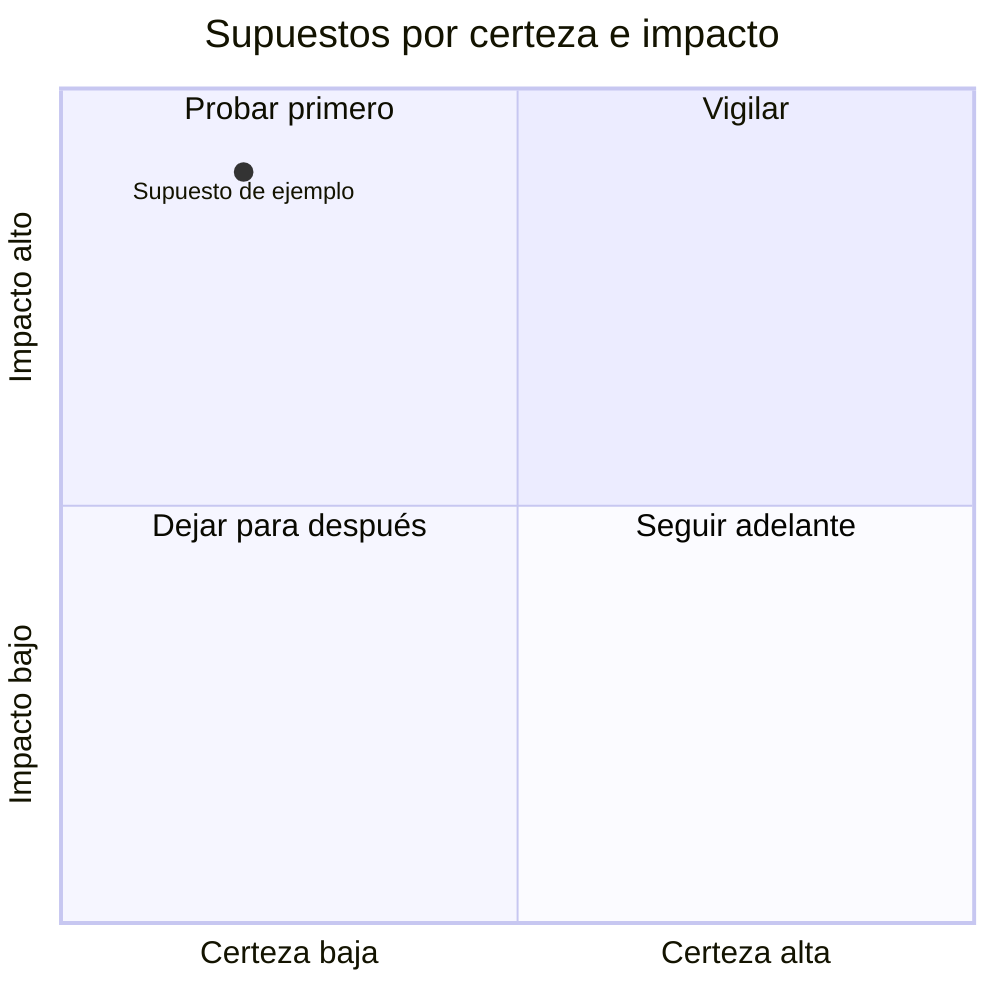

# Registro de supuestos

Proyecto: ___  Fecha: ___  Versión: borrador 1
Solución o concepto (`CON-nn`): ___
Etiqueta por defecto: lo que la persona afirma sin evidencia es **Supuesto**; lo que nadie ha verificado es **Pendiente por validar**. No reutilices IDs `SUP-nn` de etapas anteriores.

## 1. Supuestos por categoría

Una categoría por turno. Pregunta guía de cada una en `references/herramientas.md`.

| ID | Categoría | Supuesto (frase afirmativa y comprobable) | Procedencia |
|---|---|---|---|
| SUP-01 | Problema | | Dicho por participante / Supuesto |
| | Usuario | | |
| | Comportamiento | | |
| | Propuesta de valor | | |
| | Factibilidad | | |
| | Adopción | | |
| | Viabilidad | | |

## 2. Calificación (solo los 3 a 5 que más preocupan)

Alto, medio o bajo. La IA propone la calificación a partir de lo que dijo la persona y la persona la corrige.

| ID | Impacto si es falso | Certeza hoy (evidencia real) | Costo de equivocarse | Evidencia (`HAL-nn`, `PRU-nn`) | Procedencia de la calificación |
|---|---|---|---|---|---|
| | | | | | Inferencia de la IA, corregida por la persona |

Lectura: arriba van los de **impacto alto, certeza baja y costo alto**. El orden es una guía; elige la persona.

## 3. Supuesto priorizado

| Campo | Contenido |
|---|---|
| Supuesto elegido | `SUP-nn`: ___ |
| Por qué es el más arriesgado (en palabras de la persona) | |
| Decisión | `DEC-nn`, tomada por: ___ |
| Supuestos que quedan en espera | |

## 4. Mapa de riesgo (equivalente en tabla del diagrama)

| Cuadrante | Certeza | Impacto | Qué hacer |
|---|---|---|---|
| Probar primero | Baja | Alto | Diseñar la tarjeta de prueba ya |
| Vigilar | Alta | Alto | Mantener atención, volver a verificar si cambia el contexto |
| Dejar para después | Baja | Bajo | Anotar y revisar en la siguiente vuelta |
| Seguir adelante | Alta | Bajo | No hace falta probar |

## 5. Riesgos y pendientes por validar

| ID | Riesgo | Impacto | Mitigación |
|---|---|---|---|
| RIE-01 | | | |

- Pendiente por validar: ___
- Siguiente paso: completar `tarjeta-de-prueba.md` para el supuesto priorizado.
