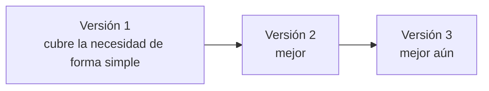

# Tarjeta de prueba

Proyecto: ___  Fecha: ___  Versión: borrador 1
Prueba (`PRU-nn`): ___  Prueba el supuesto (`SUP-nn`): ___  Concepto (`CON-nn`): ___
Regla: completar y acordar toda la tarjeta **antes** de ejecutar la prueba. Sin números ni umbral no hay tarjeta.

## 1. La tarjeta

| | |
|---|---|
| **Creemos que…** (el supuesto, como frase afirmativa) | |
| **Para verificarlo, haremos…** (el experimento mínimo) | |
| **Y mediremos…** (la métrica, con su unidad) | |
| **Acertamos si…** (el umbral decidido antes de ejecutar) | |

Ejemplo de umbral expresado como número: si voy donde 100 clientes, al menos 50 deben comprarme.

## 2. Alcance y método

| Campo | Contenido |
|---|---|
| A quién (perfil y cuántas personas) | |
| Método (técnica del experimento) | |
| Qué se simula o se hace a mano | |
| Qué NO tiene a propósito | |
| Duración y fecha de ejecución | |
| Costo aproximado | |

## 3. Regla de decisión (antes de ejecutar)

| Si el resultado es… | Entonces… (decisión de la persona) |
|---|---|
| Alcanza o supera el umbral | Continuar: pasar al siguiente supuesto |
| Queda cerca del umbral | Iterar: ajustar la solución o el experimento y repetir |
| Queda lejos, y se entiende por qué | Pivotar: cambiar el problema, el segmento o la solución |
| Queda lejos y no hay forma de mejorarlo | Detener: guardar lo aprendido |

La decisión final (`DEC-nn`) se toma al ver los resultados en `probar-y-aprender`.

## 4. Revisión del MVP (Kniberg)

| Pregunta | Respuesta |
|---|---|
| ¿Qué necesidad completa entrega la versión de la prueba? | |
| ¿Qué tan simple o manual es? | |
| ¿Es una pieza suelta (rueda, chasis) o una versión usable (patineta, bicicleta)? | |
| ¿Qué versión mejor viene después? | |

| Versión | Qué entrega | Qué se aprende |
|---|---|---|
| 1 | | |
| 2 | | |
| 3 | | |

## 5. Riesgos y pendientes por validar

| ID | Riesgo | Impacto | Mitigación |
|---|---|---|---|
| RIE-01 | | | |

- Resultado: Pendiente por validar hasta ejecutar.
- Lista de calidad: el supuesto es comprobable; la métrica tiene unidad; el umbral está escrito antes de probar; la regla de decisión tiene las cuatro salidas; el MVP cubre la necesidad completa.
- Siguiente paso: ejecutar y registrar en el Tablero de Validación (`probar-y-aprender`).
